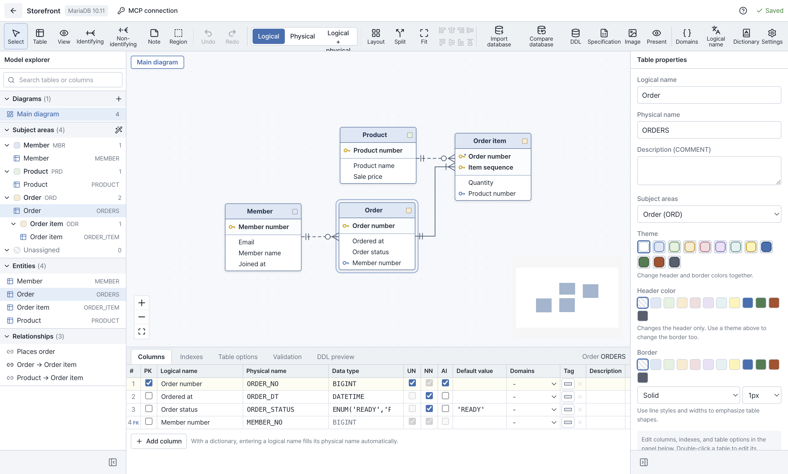
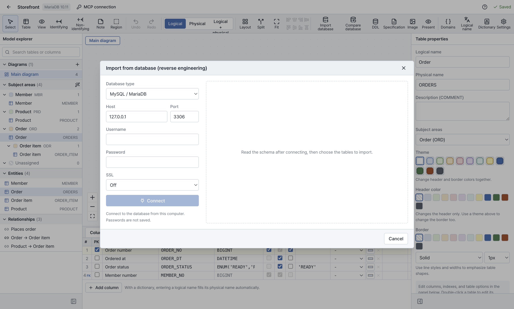
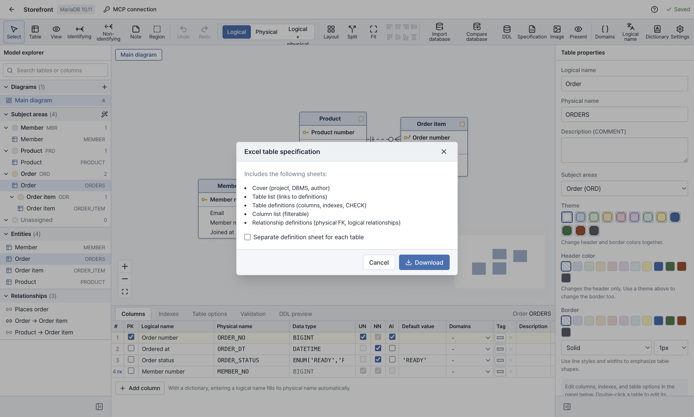
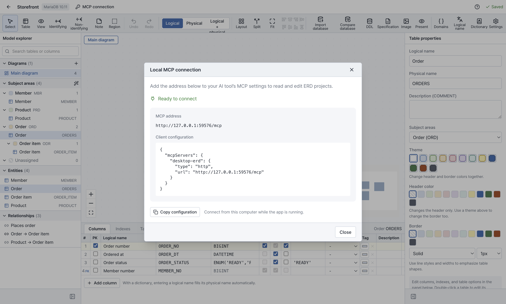

# Midnight ERD

[English](#english) · [한국어](#한국어)

## English

### See how your tables fit together

Understand an existing database, plan a new feature, or prepare a table specification for your team. Midnight ERD brings tables, columns, and relationships onto one canvas, with diagrams and Excel documents you can take into the next conversation.

[Download for Mac — Apple Silicon](https://github.com/midnightai-apps/midnightai-erd-releases/releases/latest)

### Take a look around

*A four-table example opened in the macOS app.*

1. **Explore the model.** Find a table in the explorer and follow its relationships on the canvas.
2. **Work on the details.** Review columns and keys, and keep logical names alongside database names.
3. **Prepare the handoff.** Export a diagram or an Excel table specification from the same model.

### Start with the database you already have

Import schema information from **MySQL, MariaDB, Microsoft SQL Server (MSSQL), or PostgreSQL**. Choose the tables you need and bring their structure into a local ERD project.

Schema import reads database structure without changing the source database. Use the imported model to understand relationships and plan your design.

### Work through a new design on the canvas

Create tables, add columns and keys, and connect relationships. Use logical and physical views to move between the names people use and the names in the database. Your projects are saved on your Mac, so you can reopen a design and continue where you left off.

### Take the diagram and the details into your next review

Export the diagram as **PNG, SVG, or PDF**. For a larger diagram, choose a PDF split across pages to keep the details readable.

Create an **Excel table specification (.xlsx)** with a cover, table list, table definitions, column list, and relationships. Domains and dictionary entries are included when present. Choose a separate sheet for each table when that makes the document easier to review.

| What you want to take with you | Format |
| --- | --- |
| A diagram for a document or presentation | PNG, SVG, PDF |
| Table and column specifications | Excel (.xlsx) |
| Dictionary entries and domains to edit and bring back | Excel (.xlsx), import and export |
| A project to back up or open in Midnight ERD | .erd.json, import and export |

### Reuse names and types across your model

Keep dictionary entries and domains with the project. Export them to Excel, review or edit the workbook, then import it back. The import preview shows additions, updates, and duplicates before you apply the changes.

### Connect the AI tools you already use

Use Local MCP to read and edit ERD projects through an external AI client while the app is running.

1. Open **MCP connection → Local MCP connection**.
2. Choose **Copy configuration** and add it to your client's MCP settings.
3. Keep Midnight ERD open on the same computer. Start with `list_projects` to find a project.

The default address is `http://127.0.0.1:38317/mcp`. Use the address shown in the app; the local connection does not require an authentication token. The AI client provides the AI features and must support the app's HTTP MCP connection.

### Install and update

Download the **Apple Silicon Mac** DMG above, open it, and drag Midnight ERD into **Applications**.

Starting with **1.0.1**, the app checks for updates and downloads them automatically. A downloaded update is applied after you quit the app. To check manually, choose **Help → Check for updates**.

If you have **1.0.0**, install the latest DMG once to start receiving automatic updates.

### Choose your language

Choose **Language → English / 한국어** from the menu bar.

### Support

[midnightai@midnightai.net](mailto:midnightai@midnightai.net)

---

## 한국어

### 테이블의 관계부터, 설계의 세부 내용까지

기존 데이터베이스를 파악하거나 새 기능의 구조를 설계할 때, 팀에 전달할 테이블 명세서가 필요할 때 사용해 보세요. Midnight ERD에서 테이블·컬럼·관계를 한눈에 보고, ERD와 Excel 문서로 정리할 수 있어요.

[Mac용 다운로드 — Apple Silicon](https://github.com/midnightai-apps/midnightai-erd-releases/releases/latest)

### 화면으로 먼저 살펴보세요

*macOS 앱에서 테이블 4개로 구성한 예제를 연 화면이에요.*

1. **모델을 살펴보세요.** 탐색기에서 테이블을 찾고, 캔버스에서 연결된 관계를 따라가 보세요.
2. **세부 내용을 정리하세요.** 컬럼과 키를 확인하고, 논리명과 데이터베이스에서 쓰는 이름을 함께 관리하세요.
3. **검토할 자료를 만드세요.** 같은 모델에서 ERD와 Excel 테이블 명세서를 내보낼 수 있어요.

### 사용 중인 데이터베이스에서 시작하세요

**MySQL·MariaDB·Microsoft SQL Server(MSSQL)·PostgreSQL**에서 구조를 가져올 수 있어요. 필요한 테이블을 골라 로컬 ERD 프로젝트로 정리하세요.

구조 가져오기는 원본 데이터베이스를 변경하지 않고 구조 정보만 읽어요. 가져온 모델에서 관계를 파악하고 다음 설계를 검토해 보세요.

### 새 설계는 캔버스에서 구체화하세요

테이블을 만들고 컬럼과 키를 추가한 뒤 관계를 연결하세요. 논리·물리 보기를 바꾸며 업무에서 쓰는 이름과 데이터베이스 이름을 함께 살펴볼 수 있어요. 프로젝트는 Mac에 저장되어, 다시 열고 이어서 작업할 수 있어요.

### ERD와 명세서를 함께 전달하세요

ERD는 **PNG·SVG·PDF**로 저장할 수 있어요. 큰 다이어그램은 PDF를 여러 페이지로 나눠 세부 내용을 읽기 좋게 내보내세요.

**Excel 테이블 명세서(.xlsx)**에는 표지·테이블 목록·테이블 정의·컬럼 목록·관계가 담겨요. 모델에 사전과 도메인이 있으면 함께 포함돼요. 필요하면 테이블마다 시트를 나눌 수 있어요.

| 필요한 자료 | 파일 형식 |
| --- | --- |
| 문서나 발표 자료에 넣을 ERD | PNG, SVG, PDF |
| 테이블·컬럼 명세서 | Excel (.xlsx) |
| 수정한 뒤 다시 가져올 사전·도메인 | Excel (.xlsx), 가져오기·내보내기 |
| 백업하거나 Midnight ERD에서 열 프로젝트 | .erd.json, 가져오기·내보내기 |

### 사전과 도메인도 Excel로 정리하세요

프로젝트에서 쓰는 단어와 도메인을 Excel로 내보내 검토하고, 수정한 파일을 다시 가져오세요. 적용 전에 추가·수정·중복 항목을 미리 확인할 수 있어요.

### 사용하던 AI 도구와 연결하세요

Local MCP로 외부 AI 클라이언트를 연결하면, 실행 중인 앱의 ERD 프로젝트를 조회하고 편집할 수 있어요.

1. **MCP 연결 → 로컬 MCP 연결**을 여세요.
2. **설정 복사**를 누르고 AI 클라이언트의 MCP 설정에 추가하세요.
3. 같은 컴퓨터에서 Midnight ERD를 열어 두세요. `list_projects`로 프로젝트 목록부터 확인할 수 있어요.

기본 주소는 `http://127.0.0.1:38317/mcp`예요. 앱에 표시된 주소를 사용하면 되고, 로컬 연결에는 인증 토큰이 필요하지 않아요. AI 기능은 연결한 클라이언트에서 제공하며, 앱의 HTTP MCP 연결을 지원하는 클라이언트를 사용해야 해요.

### 설치와 업데이트

위의 **Apple Silicon Mac용 DMG**를 받아 열고, Midnight ERD를 **응용 프로그램** 폴더로 옮기세요.

**1.0.1부터** 새 버전을 자동으로 확인하고 다운로드해요. 다운로드한 업데이트는 앱을 종료한 뒤 적용돼요. 직접 확인하려면 **도움말 → 업데이트 확인**을 선택하세요.

**1.0.0**을 사용 중이라면 최신 DMG로 한 번 설치해 주세요. 이후에는 자동 업데이트를 받을 수 있어요.

### 언어 선택

메뉴바의 **언어 → English / 한국어**에서 바꿀 수 있어요.

### 문의

[midnightai@midnightai.net](mailto:midnightai@midnightai.net)
